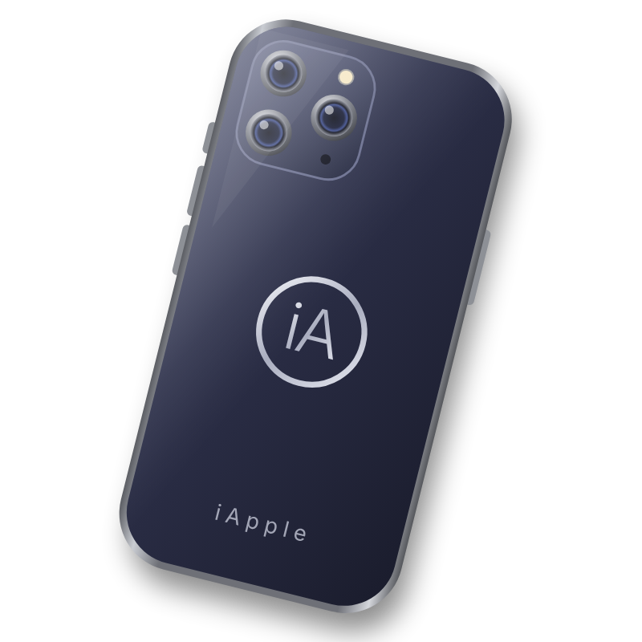
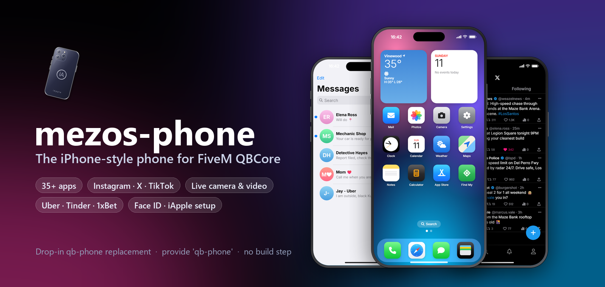

<p align="center">
  
</p>

<h1 align="center">mezos-phone — iPhone-style Phone for FiveM QBCore</h1>

<p align="center">
  <b>The modern <code>qb-phone</code> replacement:</b> iOS-style UI, 35 apps, an App Store, a real camera with photo & video,<br>
  Instagram · X · TikTok with <b>live streaming</b>, Uber, Tinder, 1xBet, DarkChat, Face ID and an iApple setup.
</p>

<p align="center">
  
  
  
  
  
</p>

<p align="center">
  
</p>

---

## Table of contents
- [Why mezos-phone](#-why-mezos-phone)
- [Screenshots](#-screenshots)
- [Features](#-features)
- [Installation](#-installation)
- [How to use (players)](#-how-to-use-players)
- [Configuration](#-configuration)
- [Photo & video storage](#-photo--video-storage)
- [For developers](#-for-developers-exports--events)
- [FAQ & troubleshooting](#-faq--troubleshooting)

---

## ✨ Why mezos-phone

- 📱 **Looks and feels like a real iPhone.** It has a Dynamic Island, lock screen, widgets, Control Centre, Notification Centre, Spotlight and dark/light mode.
- 🔌 **Drop-in replacement for `qb-phone`.** It uses `provide 'qb-phone'`, and every `qb-phone:*` event keeps working, so your other scripts need no changes.
- 🛍️ **App Store.** System apps are always installed. Players download everything else, and apps are saved per character.
- 🎥 **A real camera.** Photo and video from the phone viewfinder, real GTA filters, selfie, zoom, flash, timer and grid, plus **live streaming** to Instagram, TikTok and X.
- 🚶 **Use it on the move.** Walk or drive with the phone open; movement pauses only while typing. The camera view stays locked, so moving the mouse never spins the view.
- 🔐 **Every phone is an item with an owner.** Serial number, passcode, Face ID and an iApple **Activation Lock** come with it.
- ⚡ **Lightweight.** Vanilla JS with no build step and no framework bloat. Database tables are created automatically.

---

## 📸 Screenshots

<h3 align="center">Lock screen · Home screen · Settings</h3>
<p align="center">
  
  
  
  
</p>

<h3 align="center">Messages · X · App Store</h3>
<p align="center">
  
  
  
  
</p>

<h3 align="center">Wallet · Radio · Health · Weather</h3>
<p align="center">
  
  
  
  
</p>

---

## 🚀 Features

### System apps (always installed)
| App | Highlights |
|---|---|
| 📞 **Phone** | Calls, contacts, recents and anonymous calls; the call shows in the Dynamic Island |
| 💬 **Messages** | Chats with photos/videos, shared locations (tap to set GPS) and unread badges |
| ✉️ **Mail** | Mails from other scripts (with action buttons), offline delivery |
| 📷 **Camera** | Photo + video, filters, zoom, selfie, flash, timer, grid, live streaming |
| 🖼️ **Photos** | Gallery, viewer, **AirDrop** to a player next to you |
| 💳 **Wallet** | Bank balance, transfers, invoices / bills |
| ⚙️ **Settings** | Wallpaper, appearance, Focus / DND, airplane mode, passcode & Face ID |
| 🛍️ **App Store** | Today cards, categories, ratings, download / remove apps |
| 🛡️ **MDT** | Police only (`job = 'police'`) |

### App Store apps
| App | What it does |
|---|---|
| **Instagram** | Photo posts, double-tap likes, comments, follows, profiles, explore, notifications, **Go Live** |
| **X** | Posts, replies, reposts/quotes, likes, #trends, @mentions, who to follow, **live** |
| **TikTok** | Full-screen video feed (For You / Following), likes, comments, discover, **LIVE** tab |
| **Marketplace** | Sell vehicles, property, items and services with a photo; message or call the seller |
| **Uber** | Ride to your waypoint with the price shown up front; any player can drive; automatic fare and driver ratings |
| **Tinder** | Photo profile, swipe deck, "It's a Match!" and chat (numbers are shared only after a match) |
| **1xBet** | Virtual football / basketball / UFC all day with live scores; bets paid from and to the bank |
| **DarkChat** | Anonymous channels with a random alias; messages vanish after 3 days; can require an item (e.g. VPN) |
| **Safari** | Tabs, bookmarks, history, in-city websites and real websites |
| **Find My** | Share your live location with a contact (15 min / 1 h / until stopped) |
| **Radio** | Every GTA radio station, on foot or in a car, with favorites; plays in the Dynamic Island |
| **Health** | Health, armor, food, water, stress, step counter and a weekly chart |
| **Arcade** | Snake & 2048 with saved best scores |
| **Utilities** | Clock, Calendar, Weather, Maps, Notes, Calculator, Compass |
| **Legacy qb-phone** | Yellow Pages, Garage, Houses, Lawyers/Services, Crypto, Racing |

### In-city websites (Safari)
`eyefind.info` (search) · `weazelnews.com` (news; reporters can publish and "breaking" news notifies everyone) · `legendarymotorsport.net` (every vehicle with price, photos, finance calculator and GPS) · `dynasty8realestate.com` · `mazebank.com` · `lspd.gov` / `pillboxhospital.com` (report a crime or request EMS with your location) · `lifeinvader.com`

### Advanced
- 🔦 **Flashlight** that other players can see (from Control Centre, the lock screen or Siri)
- 🔋 **Battery.** It drains while in use and charges in a running vehicle, indoors or with a power bank. At 0% the phone turns off and calls to it fail.
- 🆘 **Emergency SOS.** Sends your location to on-duty police or EMS.
- 🗣️ **Siri in Spotlight.** Try "call maria", "text john", "go to pillbox", "flashlight on", "go live", "sos", "uber" or "12*7". Anything else searches the web.
- 📇 **Phone numbers** have 10 digits (`06…` / `07…`). Old numbers are converted automatically, and contacts and chats move with them.

---

## 📦 Installation

### Requirements
| Resource | Notes |
|---|---|
| [`qb-core`](https://github.com/qbcore-framework/qb-core) | Framework |
| [`oxmysql`](https://github.com/overextended/oxmysql) | Database |
| `qb-apartments` | Loaded as a shared config (apartment GPS / Houses app) |
| [`screencapture`](https://github.com/itschip/screencapture) | Needed by the Camera and live streaming |
| FiveM server artifact with **Node 22** | `node_version '22'` (Discord uploader) |

### Steps
1. **Download** and put the folder in your resources, e.g. `resources/[Mezos]/mezos-phone`.
2. **Remove or disable `qb-phone`.** Never run both, because `mezos-phone` provides `qb-phone`.
3. **Start the resources** in `server.cfg`, *after* the framework:
   ```cfg
   ensure oxmysql
   ensure qb-core
   ensure screencapture
   ensure mezos-phone
   ```
4. **Database:** nothing to import. The tables are created automatically on first start (see `mezos-phone.sql` for reference).
5. **Phone item:** any item listed in `Config.PhoneItems` (`phone`, `iphone`, `samsungphone`) counts as a phone. The stock QBCore `phone` item works as-is.
6. *(Recommended)* Set up photo/video storage. See [Photo & video storage](#-photo--video-storage).
7. Restart the server.

> **Optional item:** add a `powerbank` item to `qb-core/shared/items.lua` to let players charge on the go (`Config.Battery.PowerbankItem`).

---

## 🎮 How to use (players)

### Opening the phone
| Key / action | What it does |
|---|---|
| **M** | Open / close the phone (rebind in *Settings › Key Bindings › FiveM*) |
| **Esc** | Put the phone away |
| `/phone` | Open the phone (command) |
| Swipe up / click the lock screen | Unlock (Face ID unlocks your own phone automatically) |
| Tap the top-left / top-right of the status bar | Notification Centre / Control Centre |
| **Search** on the Home Screen | Spotlight & Siri |

You can **walk and drive** with the phone open; the cursor stays visible. Typing in a text field pauses movement, and the camera view stays still while the phone is open.

### First start: iApple Setup Assistant
A brand-new phone item starts the iPhone setup: language, region, Wi-Fi, Face ID, passcode, iApple ID, terms, phone name, appearance and wallpaper.
- A phone **set up by another character** shows **Activation Lock**. Enter the owner's passcode to erase it and make it yours. A phone without a passcode can simply be erased.
- Changing your passcode in Settings updates the phone item too.

### Installing apps
Open the **App Store** and tap **GET** on any app. It's saved to your character. To remove an app, open its page in the App Store and tap **Delete App**. You can download it again for free.

### Camera
| Control | Action |
|---|---|
| W A S D | Walk / run while filming |
| Drag on the picture | Aim the camera (moving the mouse alone does not turn it) |
| Shutter | Take a photo · start / stop a video (max `Config.Media.MaxVideoSeconds`) |
| PHOTO · VIDEO | Switch mode |
| 0.5 · 1× · 2 · 3 | Zoom |
| Filter chips · ← → | Real GTA filters (visible in the saved photo) |
| Flip · ⚡ · ⏱ · Grid | Selfie · flash · timer · grid |
| ✕ / Backspace | Back to the Home Screen |

### Going live
Instagram (live button or **+ › Go Live**), TikTok (**+ › Go LIVE**) and X (**+ › Go live**) stream what your camera sees. Followers get a notification. Viewers can comment and send hearts, and you see comments, hearts and the viewer count on your camera. Live video has no sound.

### Sharing
- **AirDrop:** *Photos › Share › AirDrop* sends to a player standing next to you.
- **Location:** in a chat, tap **+ › Share Current Location**. The other person taps the bubble to set their GPS.

---

## ⚙️ Configuration

Everything is in **`config.lua`** (and `server/config_server.lua` for secrets).

| Option | Default | Description |
|---|---|---|
| `Config.OpenPhone` | `'M'` | Default key (players can rebind) |
| `Config.PhoneItems` | `{ 'phone', 'iphone', 'samsungphone' }` | Items that count as a phone |
| `Config.SetupAssistant` | `true` | iApple setup + Activation Lock per phone item |
| `Config.WalkWithPhone` | `true` | Move / drive with the phone open |
| `Config.ConvertOldNumbers` | `true` | Convert old numbers to `06/07xxxxxxxx` |
| `Config.Media` | `provider = 'discord'` | Photo/video storage (see below), `MaxVideoSeconds`, `MaxPerPlayer` |
| `Config.CameraFilters` | list | Filters shown in the camera (GTA timecycle modifiers) |
| `Config.Store` | list | App Store catalog: name, developer, category, rating, size, description, `job` lock |
| `Config.LegacyApps` | list | Old qb-phone apps offered in the App Store |
| `Config.Uber` / `Config.RideJobs` | | Fares, who can drive |
| `Config.Bets` | | Min/max stake and house margin |
| `Config.DarkChat` | `RequiredItem = false` | Require an item (e.g. `'vpn'`) to use DarkChat |
| `Config.Live` | | Live stream quality, viewers, max streams, bandwidth |
| `Config.Browser` | | Homepage, real internet on/off, news jobs, dealership GPS |
| `Config.Emergency` | | Police / EMS jobs, cooldown, blip time |
| `Config.Battery` | | Drain and charge rates, power bank item |
| `Config.RadioStations` | list | Stations in the Radio app |
| `Config.Places` | list | Places in the Maps app (tap = GPS) |
| `Config.BillingCommissions` | `{ mechanic = 0.10 }` | Commission per job for invoices |

**Lock an app to a job:** add `job = 'police'` to its entry in `Config.Store`. It only shows for that job.

---

## 🗂️ Photo & video storage

| Provider | Setup | Notes |
|---|---|---|
| `discord` *(default)* | Put a webhook in `server/config_server.lua`, or add `set mezos_phone_webhook "https://discord.com/api/webhooks/..."` to `server.cfg` | The webhook stays on the server. Discord links expire, so the phone stores the message id and refreshes links automatically |
| `local` | Nothing | Files are saved in `mezos-phone/media` and served by your server. This is the automatic fallback when no webhook is set |
| `fivemanage` | `set mezos_phone_fivemanage "API_KEY"` | Uploads to fivemanage.com |

If players connect through a domain or proxy and local media doesn't load, set `Config.Media.PublicUrl = 'http://YOUR_IP:30120'`.

---

## 🧑‍💻 For developers (exports & events)

**Client exports**
```lua
exports['mezos-phone']:IsPhoneOpen()                                  -- boolean
exports['mezos-phone']:ClosePhone()
exports['mezos-phone']:SendNotification(title, text, icon, color, timeout)
exports['mezos-phone']:GetBattery()                                   -- 0..100
exports['mezos-phone']:SetBattery(level)
```

**Server exports**
```lua
exports['mezos-phone']:HasPhone(source)                               -- boolean
exports['mezos-phone']:GetPhoneOwner(source)                          -- citizenid of the active phone's owner
exports['mezos-phone']:sendNewMailToOffline(citizenid, mailData)
```

**Compatibility:** every `qb-phone:*` event (mails, notifications, calls, invoices…) works unchanged. Scripts that call `exports['qb-phone']` or depend on `qb-phone` keep working through `provide 'qb-phone'`.

---

## ❓ FAQ & troubleshooting

| Question / problem | Answer |
|---|---|
| The phone doesn't open | You need one of the `Config.PhoneItems` in your inventory. Also check that `qb-phone` is not started as well. |
| Camera / live is black | `screencapture` must be started before `mezos-phone`. |
| Photos disappear after a day | You're on Discord without the refresh. Keep the webhook set; links are refreshed automatically. Or switch to `local` / `fivemanage`. |
| Local photos don't load for players | Set `Config.Media.PublicUrl` to your direct `http://IP:30120`. |
| "Activation Lock" on a phone I picked up | The phone belongs to another character. Enter their passcode, or erase it if it has none. |
| Can I change the key? | Players: *Settings › Key Bindings › FiveM › Open / close the phone*. Server default: `Config.OpenPhone`. |
| Does it work with my other qb scripts? | Yes. Events and the `qb-phone` resource name are kept. |

---

<p align="center">
  <br>
  <b>mezos-phone</b>: the iPhone-style phone for FiveM QBCore servers.<br>
  <sub>Keywords: FiveM phone · QBCore phone · qb-phone replacement · iPhone phone script · FiveM iOS phone · GTA RP phone · FiveM camera phone · FiveM Instagram TikTok Twitter phone</sub>
</p>
